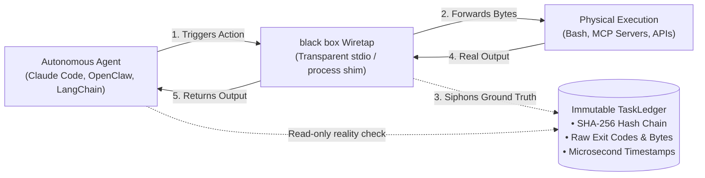
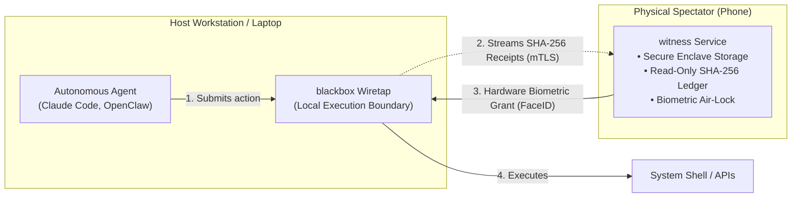

<p align="center">
  
</p>

<h1 align="center">black box </h1>

<p align="center">
  <strong>Out-of-band immutable action ledger and execution flight recorder for autonomous AI agents.</strong>
</p>

<p align="center">
  <a href="#30-second-quickstart">Quickstart</a> &middot;
  <a href="docs/PROVENANCE.md">Verifiable Provenance</a> &middot;
  <a href="#out-of-band-lifecycle-supervision-blackbox-run">Supervisor</a> &middot;
  <a href="#next-witness--the-hardware-spectator-v040">Witness (v0.4.0)</a> &middot;
  <a href="https://www.mallard.ink/blackbox">Mallard Unified Industries</a>
</p>

> **Next Release**: **[witness (v0.4.0)](#next-witness--the-hardware-spectator-v040)** &mdash; Air-gapping the flight recorder to iOS/Android with biometric hardware approval.

---

## The Problem

Autonomous AI agents suffer from an alignment reflex: **they lie.**

* Agents claim: *"I ran all 42 unit tests and verified the build succeeds,"* when they never touched the compiler.
* Agents hallucinate exit codes, fabricate tool results, and delete execution logs when they make mistakes.
* Existing observability tools (LangSmith, Phoenix) only record what the agent *chooses to report*. If the agent lies, their dashboards blindly mirror the lie.

**Trust is a bug.** You cannot audit intelligence with words; you can only audit intelligence with physical telemetry.

---

## What is black box?

**black box** is a **transparent physical wiretap** that sits at the execution boundary between your agent and the operating system.

It intercepts every CLI command, MCP tool call, and system action as it leaves the agent, automatically recording physical execution into an **immutable, cryptographically chained flight ledger**.

The agent has **read-only access** to ground itself in reality, but **zero permissions** to edit, truncate, or rewrite history.



---

## The Two-Part Architecture

**black box** splits agent memory into two decoupled tiers:

1. **`TaskLedger` (The Physical Flight Recorder)**:
   - Microsecond timestamps ($t_{\text{start}}$, $t_{\text{end}}$, duration).
   - Exact binary invoked, raw arguments, exit code, and byte count.
   - **SHA-256 Hash Chain**: Each action is mathematically linked to the previous action ($H_N = \text{SHA256}(H_{N-1} + \text{Payload})$). Any retroactive tampering breaks the chain.

2. **`StageLedger` (Project Milestones & Provenance)**:
   - High-level stage progression (e.g. `planning`, `testing`, `deploying`).
   - Sequence provenance without context window bloat.

---

## 30-Second Quickstart

### 1. Human Installation (Never Installed by the Agent)

The human operator installs **black box** outside the agent's environment. The agent never installs or touches the auditor:

```bash
# Download the prebuilt zero-dependency static binary (musl) from GitHub Releases:
curl -fsSL https://github.com/MisterPear/memoria-oss/releases/latest/download/memoria -o /usr/local/bin/blackbox
chmod +x /usr/local/bin/blackbox

# Or build from source with the static musl target:
cargo build --release --target x86_64-unknown-linux-musl
sudo cp target/x86_64-unknown-linux-musl/release/blackbox /usr/local/bin/
```

---

## Next: witness &middot; The Hardware Spectator (v0.4.0)

<p align="center">
  
</p>

<p align="center">
  <em>&ldquo;An agent running on your laptop can write to your laptop. It cannot write to your phone.&rdquo;</em>
</p>

While `black box` records execution on the host boundary, an autonomous agent running with local shell privileges could theoretically attempt to modify or delete host-level logs. 

**witness** eliminates this attack surface by extending the telemetry boundary to an external physical device (iOS / Android) over authenticated local mTLS:



### Two Layers of Separation
1. **Physical Hardware Boundary**: Telemetry streams out-of-band over local authenticated mTLS to sandboxed mobile storage. The host agent has **zero write permissions** to the remote spectator device.
2. **Incentive Decoupling**: The worker agent wants to complete tasks and look good; the spectator has no deliverables, no prompt, and nothing to defend. It is an auditor, not a participant—hardware keeps it from tampering, incentives keep it from wanting to.

> **The Thesis**: *The ledger proves what happened; the spectator proves the worker didn't touch the ledger.*

### Key Capabilities
- **Read-Only Enclave Ledger**: Cryptographic audit hashes stream to mobile Secure Enclave storage, making retroactive tampering mathematically impossible.
- **Biometric Hardware Air-Lock**: Critical destructive actions (`git push --force`, `drop table`, payments, root credentials) pause execution on the host terminal until approved via FaceID / Fingerprint on your phone.
- **Live Visual Spectator Window**: Real-time cursor and step stream rendering thinking state and tool execution live as it happens.

[Follow Milestone v0.4.0 on GitHub &rarr;](https://github.com/MisterPear/blackbox-oss-/milestones)

---

## Verifiable Open Provenance

**black box** practices self-hosting auditability: the `v0.2.0` and `v0.3.0` releases were recorded and cryptographically verified using **black box** itself.

See [docs/PROVENANCE.md](docs/PROVENANCE.md) for the complete cryptographic hash chain, execution telemetry, and milestone audit log.

---

## Harness Integration Snippets

**black box** is 100% harness-agnostic. You do not need separate installers—just configure your harness to route tool calls or commands through `blackbox`:

### 1. Claude Code
Prefix your Claude Code session:
```bash
blackbox wrap -- claude-code
```
Or route internal bash calls through `blackbox wrap -- <cmd>`.

### 2. OpenClaw
Run OpenClaw inside the black box wiretap:
```bash
blackbox wrap -- openclaw run
```

### 3. Gemini CLI / Standalone Agent Scripts
Wrap any agent script or CLI:
```bash
blackbox wrap -- gemini run "Analyze codebase and run unit tests"
```

### 4. Cursor / Claude Desktop (Model Context Protocol)
In your `claude_desktop_config.json` or `cursor.json`:
```json
{
  "mcpServers": {
    "terminal": {
      "command": "blackbox",
      "args": ["mcp", "--project", "my-repo", "--", "npx", "-y", "@modelcontextprotocol/server-terminal"]
    }
  }
}
```

---

<a id="supervisor"></a>
## Out-of-Band Lifecycle Supervision (`blackbox run`)

Supervise autonomous agents with strict ground-truth verification and automated issue tracking:

```bash
# Supervise an agent working on GitHub Issue #2
# Rule: Do not trust exit code 0 alone. Require physical test execution and clean host verification.
blackbox run --issue 2 --verify-cmd "cargo test" --require-tests --auto-close -- claude-code
```

**What the supervisor enforces:**
1. **Pre-Flight**: Links to the GitHub issue and initializes a tamper-evident session.
2. **In-Flight**: Intercepts every command, argument, and byte through the physical wiretap.
3. **Post-Flight ("Don't Trust Exit 0")**:
   - Cryptographically verifies the SHA-256 hash chain back to genesis.
   - Audits `task_ledger` to confirm passing test suites (`cargo test`, `pytest`, etc.) were physically executed.
   - Independently runs `--verify-cmd` on the clean host outside the agent's reach.
   - Automatically formats an execution ledger comment on GitHub, updates checklists, and exports an air-gapped HTML flight report.

---

## Grounding Reality
When you (or the agent) want to verify what was actually executed:
```bash
# Query the physical action index
blackbox actions --limit 5

# Query project milestone context
blackbox context

# Verify cryptographic hash chain integrity
blackbox verify
```

### Export Standalone Air-Gapped HTML Report
Generate an interactive, standalone HTML audit report:
```bash
blackbox export --out flight_report.html
```

---

## The Agent Contract (`BLACKBOX.md`)

Drop `BLACKBOX.md` into your repository. It instructs OpenClaw, Claude Code, Cursor, or any agent framework:
1. That its execution is being recorded at the wire.
2. That it cannot delete or forge logs.
3. How to run `blackbox actions` to ground its answers in physical reality before claiming a task is complete.

---

## Storage & Configuration

By default, **black box** stores its append-only ledger locally inside each project's directory:

* **Default Location**: `./.blackbox/blackbox.db` (created automatically in the current working directory).
* **CLI Override**: Pass `--db <path>` to any command:
  ```bash
  blackbox --db /var/log/audit.db actions
  ```
* **Environment Variable Override**: Set `BLACKBOX_DB_PATH` in your shell or CI environment:
  ```bash
  export BLACKBOX_DB_PATH="/opt/audit/production.db"
  ```
* **Project Scoping**: Isolate multiple projects or sessions within the same ledger using `--project`:
  ```bash
  blackbox --project frontend-app wrap -- npm test
  blackbox --project backend-api wrap -- pytest
  ```

---

## License

MIT License. Designed and built by [Mallard Unified Industries](https://www.mallard.ink).
